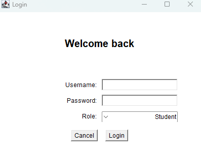
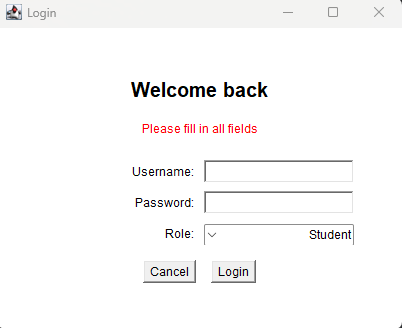
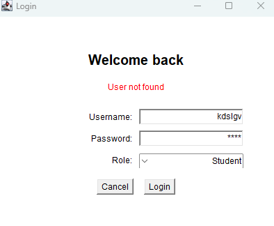
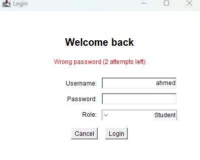
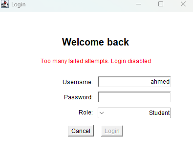
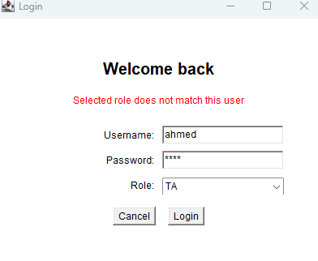
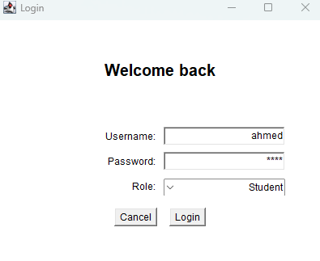
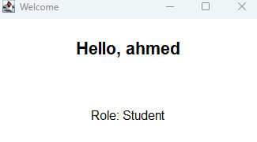

# LoginFormTask

A simple login form built with Java AWT.

## Features
- Checks that the username and password fields are not empty
- Checks that the user exists
- Checks that the password is correct
- Checks that the selected role matches the user's role
- Shows a simple error message when the data is wrong
- Disables the Login button after 3 wrong password attempts (bonus)
- Opens a welcome page showing the username and role after a successful login

## Test Users
| Username | Password | Role |
|----------|----------|------|
| ahmed | 1234 | Student |
| sara | abcd | TA |
| drmohamed | pass123 | Professor |

## How to Run
1. Open the project in IntelliJ IDEA (JDK 17 or newer)
2. Put `LoginFormTask.java` inside the `src` folder
3. Run the `main` method

## Screenshots

### Login form (initial state)

### 1. Empty fields

### 2. User not found

### 3. Wrong password

### 4. Login disabled after 3 wrong attempts (Bonus)

### 5. Wrong role

### 6. Valid data entered (before clicking Login)

### 7. Successful login

